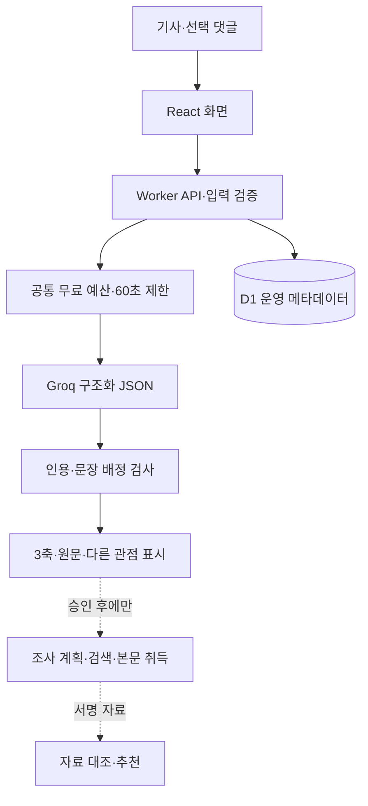

# 내 정보 맑음? — 오늘의 정보 성분표

기사를 붙여 넣으면 **논점 분포·자극성·신뢰성 검토**를 살펴보고, 다른 관점과 출처를 직접 확인하도록 돕는 한국어 미디어 리터러시 웹사이트입니다.

대상 저장소: [IsMyInforSunny/myinforSunny](https://github.com/IsMyInforSunny/myinforSunny). 이 저장소는 공개 배포 13과 그 이후의 미배포 개발 코드를 포함합니다. 코드 작성, 기능 시험, 공개 배포, 실제 정확도 평가는 서로 다른 완료 상태입니다.

## 가장 먼저 확인할 현재 상태

- 공개 사이트: https://naeinfo-clear-code2026.civilsquid9.chatgpt.site/analyze
- 공개 기준 소스: `f5a077e017a2099ca9e0cccf5ae0ecd39e710d7e` (기존 Sites 소스 저장소의 커밋).
- 공개 서비스: Groq 본문 분석, 본문·댓글 논점 분리, 표현 검토, 수동 참고자료 대조, 예시 7종.
- 자동 외부 조사·실제 관련 기사 검색은 **비활성**입니다. GDELT 어댑터와 조사 단계 코드는 있으나 운영 검색 승인과 출처 허용 목록이 없습니다.
- 최신 개발 코드: Tavily 무료 기본 검색 어댑터, Readability 기반 추출, 한글 인코딩 처리, 의견만 있는 글의 관점 탐색, 월간 검색 예산, 조사 결과 내보내기 보완. **공개 배포 완료를 뜻하지 않습니다.**
- 실제 자료 관계 판단 실패 사례와 출처 품질 정책의 미완성 문제가 남아 있습니다. 정확도·진실 확률·언론사 신뢰 점수를 주장하지 않습니다.

## 문서

| 문서 | 내용 |
|---|---|
| [기술명세](docs/TECHNICAL_SPEC.md) | 기능, 입력·출력 계약, API, 집계, 한도, 보안, 미완료 조건 |
| [아키텍처](docs/ARCHITECTURE.md) | 현재 구조, 자동 조사 경로, 신뢰 경계, 저장·실패 처리 |
| [개발 경과·시행착오](docs/DEVELOPMENT_HISTORY.md) | 방향 변경, 오류, 수정과 남은 위험 |
| [검증·출시 기준](docs/VALIDATION.md) | 과거 실행 증거와 현재 검증 상태, 수동·실서비스 검사 기준 |
| [로컬 실행](docs/SETUP.md) | 설치, 환경변수, 명령, 호스팅 경계 |
| [A4 기술 현황 PDF](docs/reports/technical-architecture-history-2026-10-31.pdf) | 13쪽 기술명세·구조도·시행착오 설명서 |

`docs/`의 v3.0~v5.0 문서는 설계 이력입니다. 현재 상태 설명의 기준은 위 문서이며, v5.0의 미완료 목록 중 일부는 최신 코드로 진행됐지만 실제 검증·배포 여부는 별도로 확인해야 합니다.

## 사용자 흐름과 3축

1. 개인정보 없는 공개·가상 본문과 선택 댓글을 입력합니다.
2. Groq 전송 동의를 확인하고 분석합니다. 예시는 외부 AI를 호출하지 않습니다.
3. 본문 논점 분포, 검토 표현, 추출 사실·의견 주장과 원문 인용을 확인합니다.
4. 공개 버전에서는 필요 시 자료 본문을 직접 넣어 선택 주장과 대조합니다.
5. 자동 조사 경로는 별도 서비스·계정·출처 승인과 실서비스 검증을 마친 뒤 연결합니다.

본문과 댓글의 분모를 분리합니다. 한 문장은 여러 논점에 속할 수 있습니다. 500자를 넘는 문장을 처리용으로 나눠도 자연 문장 수는 한 번만 셉니다. 분모가 0이면 ‘해당 없음’, 10 미만이면 건수 위주로 표시합니다. 수치는 분류 집계이며 사실일 확률이 아닙니다.

## 기술 구성

React 19.2.6, TypeScript 5.9.3, Tailwind CSS 4.2.1, Vinext 1.0.0-beta.5, Vite 8.0.13, Zod/v4, Groq `openai/gpt-oss-120b`, Cloudflare Worker·D1, Drizzle ORM, Vitest를 사용합니다. Next 호환 프로젝트이지만 실제 프레임워크 실행·빌드는 Vinext입니다. `@mozilla/readability`와 `linkedom/worker`는 최신 로컬 기사 추출 경로입니다.



## 빠른 시작

Node.js 22.13 이상과 npm이 필요합니다.

```sh
npm ci
npm run dev
# 기본 로컬 포트: 5173. 실제 출력 URL을 확인하세요.
```

기본 예시 체험은 API 키 없이 사용할 수 있습니다. 실시간 모델 호출은 `.env.example`을 참고해 서버 전용 설정·D1 바인딩·무료 계정 조건을 준비해야 합니다. 로컬 설정 파일을 Git에 올리지 마세요. `.openai/hosting.json`은 기존 Sites 배포 대상을 가리키므로 다른 환경에서 그대로 운영 배포하지 마세요.

```sh
npm run typecheck
npm test
npm run build
```

기본 시험은 모의 공급자를 사용합니다. `tests/*.live.test.ts`의 실제 Groq 시험은 명시적인 opt-in과 승인된 로컬 키 파일이 필요하며 기본 실행에서는 건너뜁니다. 실제 시험에 개인 입력을 넣지 마세요.

## 무료 운영과 개인정보

- 유료 자동 fallback·자동 재시도 없음. 검색 실패 시 가짜 링크로 대체하지 않음.
- Groq 요청 예약 6,500토큰, 출력 최대 2,000토큰, 전역 동시 모델 호출 1개, 요청 60초.
- IP별 모델 요청 3회/분·20회/시간, 내부 하루 120,000토큰·최대 500요청. 실제 처리량은 토큰 제약에 따라 더 적습니다.
- 검색 별도 안전 상한 3회/분·20회/시간·전역 200회/일. Tavily는 확인된 무료 월 크레딧의 80%, 최대 800개를 보수적으로 예약합니다.
- D1에는 요청 시각·HMAC 호출자·예산·공급자 대기 정보만 저장합니다. 제품의 기사·검색어·분석 기록 DB는 만들지 않습니다.
- 서버 키, 실제 환경변수 파일, `.sites-runtime`, 사용자 원문, 로컬 실험 결과는 공개 저장소에서 제외합니다.
- 외부 AI·검색 제공자의 데이터 처리 정책은 별도로 적용됩니다.

## 저장소 구조

`app/`: 페이지·API / `components/`: 화면 / `lib/`: 계약·집계·실행기 / `lib/server/`: 제공자·검색·취득·예산 / `db/`, `drizzle/`: 운영 저장소 / `tests/`: 회귀·명시적 실제 시험 / `research/`: PCA·SVM 및 평가 준비 / `extension/`: 확장 연구 코드 / `docs/`: 문서.

연구·확장 코드가 있다는 이유로 해당 기능이 공개 MVP에서 학습·활성화됐다고 해석하지 않습니다. `research/`의 과거 ‘API 없이 자체 엔진’ 설명은 별도 연구 이력이며 현재 서비스의 실행 방식이 아닙니다.

## 협업·라이선스

Claude는 문장 구간·본문 논점 분포 및 경계 검토, Codex는 통합·자동 조사·보안·시험·문서를 담당했습니다. 실제 실행 결과와 미검증을 구분하고 같은 파일을 동시에 수정하지 않습니다. 상세 인수인계·과거 문서는 이력으로 보관합니다.

프로젝트 자체의 재사용 라이선스는 아직 확정하지 않았습니다. 공개 저장소라는 이유만으로 재배포 허락을 추정하지 마세요. 포함된 서드파티 코드·의존성의 라이선스와 고지는 각각 유지합니다. 기사 본문 이용 권한은 검색 API의 이용 조건과 별도입니다.
