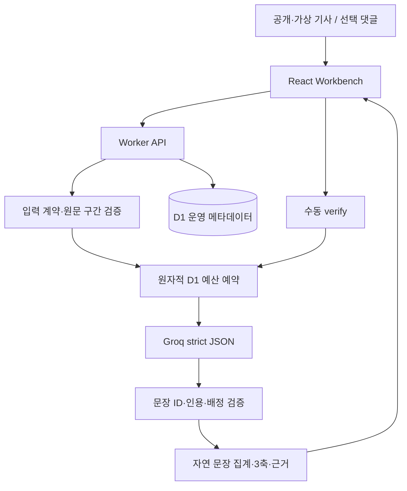
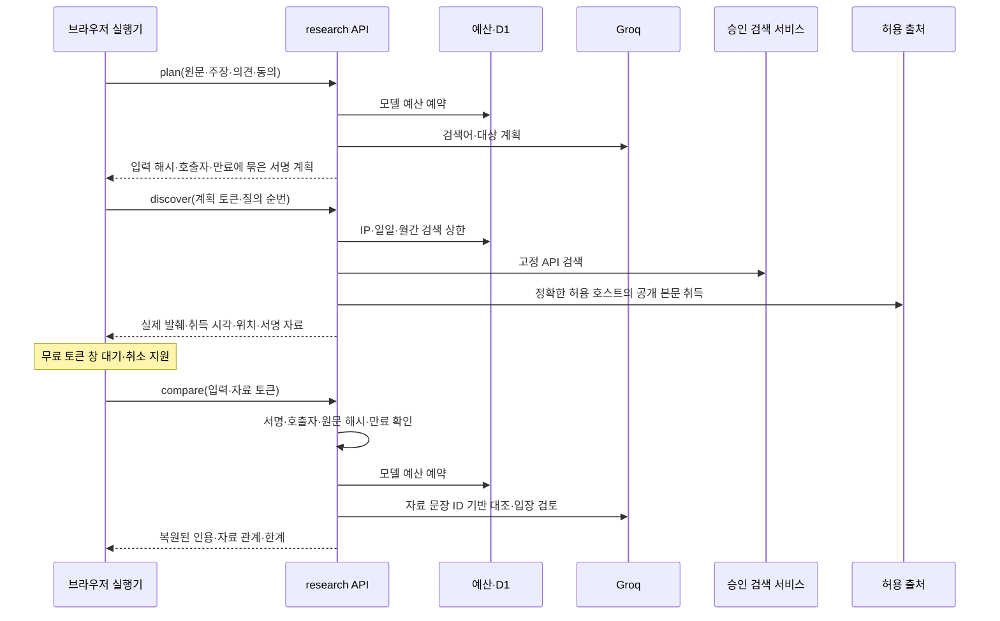

# 아키텍처

## 1. 공개 구조

화면은 입력·결과·취소·원문 강조·내보내기를 관리한다. 서버는 원문 위치·분모·출처 취득 여부·무료 예산을 결정한다. 모델은 의미 분류를 제안하며 서버의 인용 검사가 그 의미의 정확성까지 입증하지는 않는다. 호스팅은 Sites 관리 Worker이며 사용자 PC 상시 서버가 아니다.

## 2. 자동 조사 경로 — 운영 비활성

공개 환경의 검색 플래그가 꺼져 있으므로 이 흐름은 실제 사용 기능으로 간주하지 않는다. 최신 의견 탐색·추출·Tavily·월간 예산 변경도 미배포 상태다.

## 3. 책임과 코드

| 영역 | 파일 |
|---|---|
| 입력·결과 UI | components/workbench.tsx |
| 본문·댓글 분포 | components/topic-distribution.tsx |
| 자동 조사 UI·실행 | components/reliability-research.tsx, lib/research-runner.ts |
| 공통 계약 | lib/contracts.ts, lib/research-contract.ts |
| 문장·인용·집계 | lib/segmentation.ts, lib/domain.ts, lib/display.ts, lib/report-status.ts |
| 본문 의미 분석 | lib/server/analyze.ts |
| 자료 대조·인용 복원 | lib/server/verify.ts |
| 조사·서명 | lib/server/research.ts, lib/server/research-token.ts |
| 검색 제공자 | lib/server/news.ts, tavily-search.ts, search-settings.ts |
| 원문 추출 | lib/server/retrieval.ts, article-extraction.ts |
| 모델·토큰 계산 | lib/server/language.ts, providers/groq.ts |
| 한도·운영 저장 | lib/server/budget.ts, limits.ts, search-budget.ts, db/schema.ts |

## 4. 신뢰 경계

1. 사용자 원문은 분석할 데이터다. 원문 안의 명령을 시스템 명령으로 실행하지 않는다.
2. 사용자 제공 자료는 URL이 있어도 provided_text다. 서명한 서버 취득 자료만 web_fetched로 사용한다.
3. 검색 후보는 사실·반대 입장 인증이 아니다. 본문·정확한 인용·자료 관계를 확인한다.
4. 문장 ID는 서버가 보유한 실제 구간으로 복원한다. 모델 생성 quote와 임의 오프셋을 그대로 신뢰하지 않는다.
5. 서명 묶음은 변조·다른 호출자·입력 변경·만료를 검사한다. 암호화나 원자료 진실 인증은 아니다.
6. 도메인 허용 목록은 네트워크 목적지 제한이다. 허용된 사이트의 모든 내용을 정답으로 취급하지 않는다.
7. 모델 키·서명 재료는 브라우저·로그·Git으로 전달하지 않는다.

## 5. 저장·실패 처리

request_budget: 모델 예약·소비·활성 상태·호출자 HMAC. provider_backoff: 공급자 대기 시각. research_search_budget: 검색 요청·HMAC·시각. search_monthly_budget: 로컬 신규 월간 합계. 기사·검색어·분석 결과를 저장하는 테이블은 없다.

예산 예약은 D1 조건부 SQL로 동시 요청에서도 제한한다. 모델의 알 수 없는 사용량은 보수적 예약으로 유지한다. 서버 장애·형식 오류·요청 취소·검색 빈 결과를 가짜 결과로 대체하지 않는다. 브라우저에는 확보된 부분 결과를 남기고 아직 검토하지 않은 대상을 표시한다.

긴 자동 작업을 한 요청으로 수 분 열어 두지 않고 plan/discover/compare로 분리한다. 대기와 취소는 브라우저 실행기가 담당한다. 기본 제공자 실패를 유료 제공자나 다른 키로 자동 우회하지 않는다.

## 6. 구조적 미완성

원자료 수집 경로, 출처 계보·전재 중복, 숫자·단위·대상·시점의 정형 비교, 정정·철회, 독립 근거 선정은 보완해야 한다. 앞부분 8,000자·발췌 1,500자로 문맥을 놓칠 수 있다. 발행일 메타데이터를 모델 대조에 충분히 전달하지 않고, 시점 차이에 대한 프롬프트가 충돌한다. 추천과 신뢰성 집계의 시간/범위 기준을 통일해야 한다.

연구 폴더의 임베딩·PCA·SVM 경로는 별도 실험이다. 공개 LLM 결과를 해당 모델의 평가 결과로 재사용하거나, PCA 축을 찬반·정치 성향으로 명명하지 않는다.
