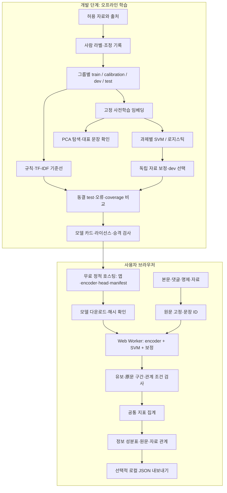
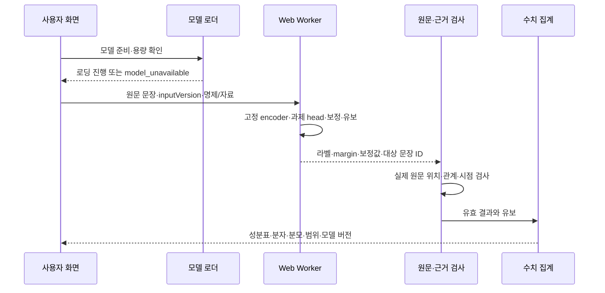

> 과거 버전: 현재 기준은 [내정보맑음_아키텍처_v4.0.md](내정보맑음_아키텍처_v4.0.md)입니다.

# 내 정보 맑음? — 아키텍처 v3.0

2026-10-30 · 현재 기준. 기술명세·개발계획 v3.0과 함께 적용합니다. 외부 LLM이 분석 후보를 생성하던 v2 운영 경로를 대체합니다.

## 1. 결정과 원본 연결

PPT의 역할 분리는 사전학습 언어 표현과 팀의 수학적 측정·검증입니다. API는 원본에 제시된 구현 예시지만 사용자의 무결제 조건에 따라 이번 버전에서 제외합니다. 임베딩은 공개 사전학습 모델을 고정해 실행하고, 팀이 과제별 SVM·보정·유보·근거·평가를 구현합니다. 사전학습 모델 전체를 자체 개발했다고 주장하지 않습니다.
학습은 개발 단계의 일회성 작업이며 서비스 요청마다 재학습하지 않습니다. 최종 사용자는 개발자 PC의 서버에 접속하지 않고 자신의 브라우저에서 추론합니다. 정적 호스팅 적합성은 모델 용량·속도 실측을 거쳐 확정합니다.

## 2. 전체 흐름

원문이 호스팅 서버·외부 AI로 전달되는 화살표는 없습니다. 공개 호스팅은 프로그램·모델 파일을 전달합니다. 브라우저의 기기 연산은 필요하지만 개발자 PC를 상시 켜 둘 필요는 없습니다.

## 3. 학습 모듈

| 모듈 | 책임 | 경계 |
|---|---|---|
| dataset | 출처·권리·라벨·분할·중복 검증 | 서비스 입력 자동 수집 금지 |
| embeddings | encoder revision·tokenizer·pooling·정규화 기록 | 모델 버전 혼합 금지 |
| train | train-only scaler·SVM·multi-label head | test fit 금지 |
| calibration | calibration-only sigmoid/선택 보정법 | 단순 margin을 확률로 표시 금지 |
| evaluation | dev 선택·동결 test·누수·coverage·오류 | 합성 자료를 실사용 성능으로 주장 금지 |
| projection | PCA fit·분산·대표 문장 | PC 축을 찬반 정답으로 명명 금지 |
| exporter | JSON head·버전·해시·모델 카드 | 원문·pickle·비밀키 배포 금지 |

1차 실행 코드는 표현 이진 head부터 구현하지만, 논점·입장·근거에는 별도 과제 계약과 head가 필요합니다. 표현 모델을 그대로 세 축에 돌려 쓰지 않습니다.

## 4. 추론 모듈과 시퀀스

Worker에 임의 URL 실행이나 코드 실행 권한을 주지 않습니다. UI는 로딩·취소·오래된 결과·기기 미지원 상태를 소유합니다. 공통 domain 모듈이 정확한 UTF-16 구간과 집계를 소유하며 모델이 비율을 직접 만들지 않습니다.

## 5. 세 축의 책임 분리

논점 head는 사전에 정의한 범위의 multi-label을 출력하고, 명제별 입장은 별도 pair head가 담당합니다. 전체 사회 여론과 사용자의 이념을 추론하지 않습니다.
표현 head는 문장 분류와 기준별 라벨을 출력합니다. 설명은 기준 정의·관찰한 원문·필요시 선형 특징 기여를 표시합니다. 생성 모델의 설명을 SVM 인과 설명으로 붙이지 않습니다.
근거 모듈은 사용자 확인 주장 → 입력 자료 문장 검색 → 관계 head → 시점·대상·수치 확인 → 인용·상충 집계 순서입니다. 검색 유사도는 진실 점수가 아닙니다. 관계 head 미준비는 unchecked입니다. 자동 웹 검색은 현재 의존성에서 제외합니다.

## 6. 저장·버전·배포

- 개발 저장소: 소스·라벨 지침·스키마·재현 명령·라이선스 기록. 비공개 원문 자료와 모델 캐시는 별도 제외.
- 모델 저장소: 승인한 encoder와 JSON head·manifest·모델 카드. 공개 재배포 권리와 크기 한도를 검사.
- 브라우저 메모리: 원문·중간 벡터·결과. 지속 저장은 모델 캐시에 한정하고 원문은 자동 저장하지 않음.
- 서버: 정적 앱·모델 전달. 기존 Sites 예시 API는 전환기에 유지할 수 있으나 외부 AI inference는 금지.
- GitHub Pages 후보: 정적 빌드와 하위 경로·Worker·WASM 경로를 검증한 뒤 이관. 현재 Sites가 이미 GitHub Pages로 바뀐 것은 아님.

모델 manifest의 encoder/head 호환 버전·차원·SHA-256을 확인하고 불일치 시 실행을 거절합니다. 모델 교체는 승격 기록과 함께 수행하며 같은 결과에 다른 버전의 head를 섞지 않습니다.

## 7. 실패와 과제별 활성화

| 상황 | 동작 |
|---|---|
| 승인 모델 없음 | model_unavailable·예시 선택 가능 |
| 용량·메모리·기기 한도 | 크기·사유 표시, 사용자 취소·경량 모델 선택 |
| 학습 범위 밖·불확실 | undetermined + coverage 표시 |
| 일부 head 미준비 | 해당 축 미구현/미대조 표시, 다른 축 정상 결과와 분리 |
| 자료 상충 | conflicting, 인용 양쪽 제공 |
| 원문 구간·해시 불일치 | 결과 거부, 가짜 성공 금지 |
| 네트워크 없음 | 캐시 모델 준비 시 처리, 미준비 시 다운로드 실패 표시 |
| 분석 중 입력 변경 | 이전 inputVersion 결과로 명시, 최신 입력 결과로 덮어쓰지 않음 |

## 8. 결정 기록과 완료 증거

ADR-01 외부 AI API 제거: 사용자의 무결제·자체 엔진 요구. 무료 API도 학습 엔진 구현을 대신하지 않음.
ADR-02 사전학습 임베딩 유지: PPT의 일정·역할 분리. 직접 구현 범위는 과제 head·수학·검증이며 pretrained까지 자체 개발했다고 주장하지 않음.
ADR-03 PCA와 분류 분기: 분산 최대 축은 찬반 축이 아님. 차원축소의 분류 기여는 별도 실험.
ADR-04 브라우저 추론 우선: 개발자 PC 상시 서버·API 키·추론 서버 비용 제거. 단점은 기기별 속도·메모리·모델 다운로드이며 실측 후 채택.
ADR-05 데이터 평가가 승격 조건: 사람 라벨·분할·외부 시험 없이는 모델 품질 미검증. 합성 smoke test와 제품 성능을 분리.
ADR-06 수용 범위 유지: 세 축·원문·자료 관계·유보·확장 시제품은 최종 범위. 먼저 만든 표현 분류기만으로 전체 완료 처리하지 않음.

완료 증거는 평가 artifact와 모델 카드, Python/브라우저 점수 parity, 실제 한국어 사례, 모바일 메모리·지연, 공개 사이트의 개발자 PC 비의존 실행입니다. 설계도나 테스트 개수만으로 전체 완성을 주장하지 않습니다.
