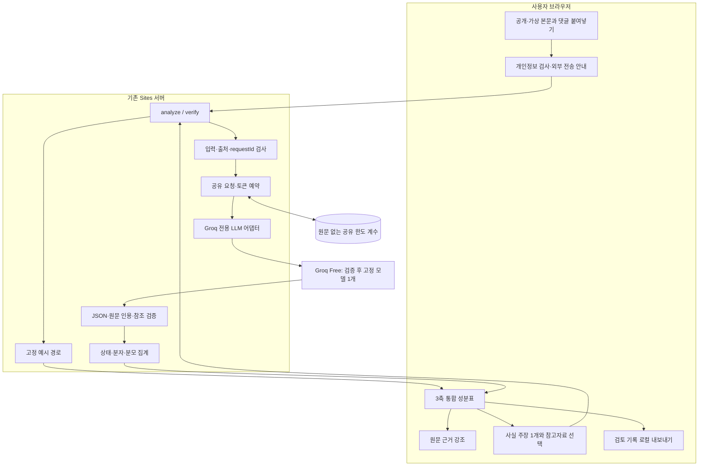
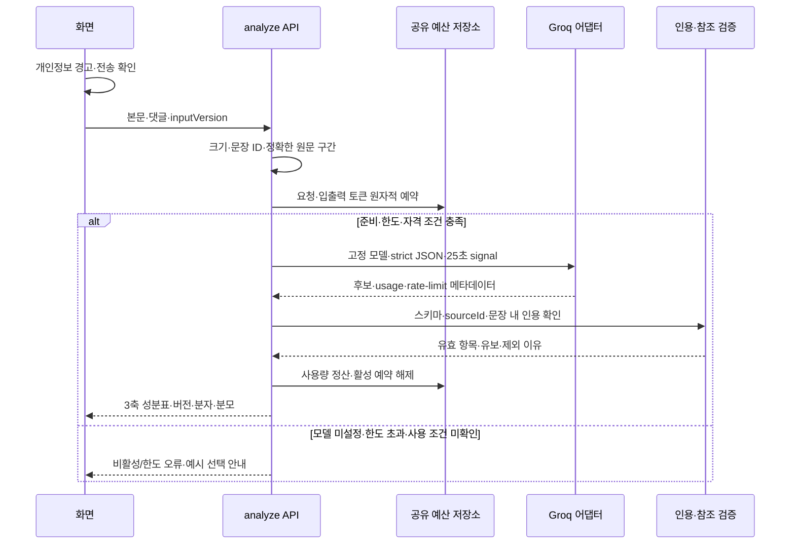
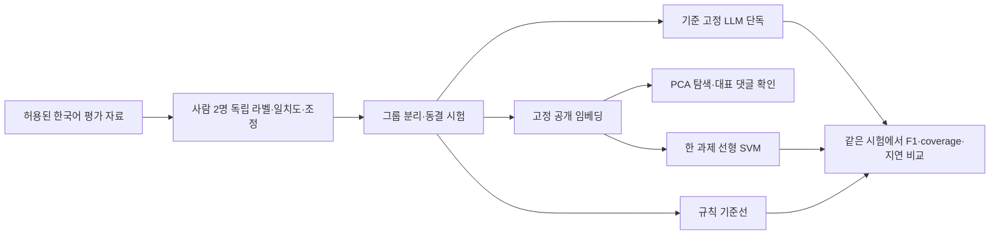

> 보관본: 현재 개발 기준은 같은 이름의 v4.1 문서입니다.

# 내 정보 맑음? — 아키텍처 v4.0

2026-10-30 · **현재 개발 기준**. 기술명세 v4.0·개발계획 v4.0과 함께 적용합니다. v3의 브라우저 자체 분류기 필수 배포를 대체합니다. 구현 완료도가 아니라 목표 구조이며 현재 코드는 예시 모드입니다.

## 1. 설계 결정

필수 MVP는 **M0 예시 UI + M1 무료 LLM 분석·인용 검증·입력 자료 대조**입니다. M2 임베딩/PCA, M3 라벨 기반 SVM 비교는 선택 연구로 분리합니다. 모든 화면과 문서의 축 이름은 **논점 분포 / 자극성 / 근거 충분성**입니다.
Groq Free를 조건부 1순위로 두고 한국어·strict JSON·계정 사용 자격·실행 시간·실제 무료 한도를 확인한 뒤 모델 하나를 고정합니다. Gemini는 청소년 대상 API 제한, GitHub Models는 서비스 종료 때문에 제외합니다. 실패 시 타 제공자/유료 모델로 자동 우회하지 않습니다.
비밀키·검증·예산을 가진 서버가 필요합니다. 현재 Sites 서버를 우선 재사용하며 개발자 PC 상시 서버나 정적 GitHub Pages 단독을 기본 경로로 삼지 않습니다. GitHub 코드 보관과 AI 호출·서버 호스팅은 다른 역할입니다.

## 2. 필수 서비스 구조

무료 LLM이라고 원문 전송이 없어지는 것은 아닙니다. 사용자 확인 후 필요한 텍스트가 서버를 거쳐 Groq로 전달됩니다. 원문을 DB·로그에 저장하거나 연구 자료로 자동 복사하지 않습니다. 예시는 실제 요청 실패를 가리는 자동 대체 수단이 아닙니다.

## 3. 기본 분석 시퀀스

외부 호출은 요청당 1회, 자동 보완 재호출 없음, 전체 마감 40초입니다. 네트워크·불완전 응답은 가짜 성공으로 바꾸지 않습니다. 원문 검증 실패 항목은 유보하며 ‘원문 인용 일치=해석 정답’으로 취급하지 않습니다. 새 입력의 이전 결과는 inputVersion으로 구별합니다.

## 4. 자료 대조 경계

사용자 확인 사실 주장 1개 + 입력 자료 본문 최대 2개 → 별도 verify 예약 → LLM 관계 제안 → 인용·원문 주장 일치·시점·대상 검사 → 관계별 결과와 성분표 근거 충분성 갱신.
검색엔진·URL fetch는 MVP 의존성이 아닙니다. 붙여 넣은 자료는 provided_text이며 URL이 있어도 웹에서 취득했다고 표시하지 않습니다. 자료의 실제 본문을 읽지 못하면 원 사이트 미확인·미대조를 유지합니다. 화면의 supported는 ‘출처에서 확인됨 · 입력 자료 기준’, contradicted는 ‘입력한 출처와 다름’입니다.
자료 충돌·불충분·미대조는 실패와 구별합니다. 어느 경우에도 ‘진실 확률’이나 출처의 종합 신뢰도 점수를 만들지 않습니다. 자료 대조를 마치면 공통 집계 함수로 대조 진행률과 자료 뒷받침률을 별도 갱신합니다.

## 5. 선택 연구 구조

SVM은 라벨이 있어야 학습합니다. 직접 LLM을 학습하지 않는다는 결정과 SVM 파일럿은 모순되지 않습니다. SVM 보정은 별도 calibration 자료, 모델 선택은 dev, 최종 평가는 test로 분리합니다. PCA 시각화의 2차원만으로 분류를 강제하지 않고 최대 분산 축을 찬반·감정·정치 축으로 이름 붙이지 않습니다.
연구 실패는 기록하고 M1 서비스와 분리합니다. 실제 결과가 없으면 비교 표에 미실시로 남기며 합성 시험 성능을 한국어 성능으로 옮기지 않습니다. 기존 연구 코드는 이 모듈로 보관합니다.

## 6. 모듈 책임·저장·호스팅

| 모듈 | 소유 책임 | 금지 |
|---|---|---|
| contracts/UI | 3축 이름·상태·버전·취소·원문 클릭 | 이전 입력 결과를 새 결과로 표시 |
| input/segmenter | 개인정보 입력 검사·UTF-16 원문 구간 | 분석을 위해 원문을 몰래 변경 |
| budget | 사용자별 상한·모델별 이동창/일일 토큰 원자적 예약 | 사용자 3/min만으로 공급자 한도 보호했다고 주장 |
| groq adapter | 고정 모델·JSON 요청·25초 마감·usage | provider raw 오류·키 로깅·타 제공자 자동 전송 |
| evidence | 인용 실재·문장 ID·자료 관계 조건 | 인용 존재를 의미적 정답으로 간주 |
| indicators | 건수·분모·유보·미대조·상태 | 종합 편향·진실 확률 생성 |
| research | PCA·SVM·보정·독립 비교 | 서비스 입력 자동 학습·AI 평가자를 사람으로 기록 |

공개 운영 저장소는 요청 ID·익명화 식별자·시간·예약·사용량·활성 여부만 저장합니다. 서버 secret에는 GROQ_API_KEY만 새로 설정하며 브라우저·source·manifest에 넣지 않습니다. 키·계정 준비는 실제 연결 작업에서 안전하게 진행하고 이번 문서 수정만으로 만들지 않습니다.
단일 프로세스 시연에서는 메모리 카운터로 제한할 수 있으나 재시작하면 소실됩니다. 분산 Sites 경로에는 D1 등 공유 저장소가 필요합니다. 모델별 전체 동시성 1개·분당 예약 토큰 7K·일일 토큰 120K·일일 요청 500을 앱의 초기 보수적 상한으로 두며 정확한 계정 한도에 맞춰 조정합니다. 공급자 외부 사용량은 응답 헤더로도 확인합니다.
현재 Sites는 Worker 환경입니다. 공식 Worker 문서의 HTTP duration과 CPU 제한을 구별하며 Sites 프록시·플랜·메모리·40초 처리 가능성은 별도 배포 실측으로 확인합니다. 정적 GitHub Pages만으로 비밀키·공유 제한기를 제공하지 못합니다. 장기 무료 호스팅이 보장됐다고 쓰지 않습니다.

## 7. 실패·검증·전환

429·일일 한도 → retry-after/reset 안내와 일시 중단. 인증·모델 권한 오류 → 운영 설정 확인. JSON/인용 오류 → 유보/실패. 자료 미확인 → 미대조. 전체 마감 초과 → timeout. 무료 한도를 넘기면 자동 과금·유료 fallback·서비스 변경 없음.
활성화 전 확인: 계정 사용 자격·청소년 앱 조건·Data Controls·계정 실제 한도 → 한국어 10사례 후보 비교 → 세 축 UI/인용/집계 → 공유 토큰 예약/동시 요청 → 고정 사람 평가와 지연 → 실제 공개 주소 동작. 사전 품질 목표는 기술명세 §10과 개발계획 §5를 그대로 사용합니다.
발표 핵심은 조작 인용을 거절하는 코드와 그 한계입니다. 42.7% 배경 통계는 2024년도 조사·2025년 발표·사이버폭력 경험 종합임을 계획서와 통일합니다. 시연 자료는 가상·공개 자료이며 실제 규정 원문 검토는 별도 게이트입니다.
실시간 비활성 상태를 유지합니다. Groq 어댑터·축/관계 문구·새 입력 제한·전송 안내·분당 토큰 예약은 v4 코드에 반영했고 모의 통합 시험을 통과했습니다. 설계 변경이 실제 API 연결 성공의 증거는 아닙니다.

## 8. 결정 기록

- ADR-01: 무료 LLM으로 언어 이해, 팀은 검증·집계·평가를 구현. 직접 언어모델 학습은 제외.
- ADR-02: M0+M1 필수, M2/M3 선택. 확장·대형 브라우저 모델 배포를 필수에서 제외.
- ADR-03: 세 축 고정·한 성분표·건수 우선. 보정 확률과 집계 비율을 분리.
- ADR-04: Groq 조건부 우선. Gemini·GitHub Models 제외, 자동 multi-provider fallback 없음.
- ADR-05: 서버 secret·공유 예약. 정적 호스팅 단독은 불가, 개발자 PC 상시 실행은 불필요.
- ADR-06: 사람 평가·인용 존재 검증·해석 평가를 분리. 원문이 같아도 해석은 틀릴 수 있음.

## 공식 근거

- https://console.groq.com/docs/rate-limits
- https://console.groq.com/docs/structured-outputs
- https://console.groq.com/docs/legal/services-agreement
- https://console.groq.com/docs/your-data
- https://ai.google.dev/gemini-api/terms
- https://docs.github.com/en/github-models
- https://developers.cloudflare.com/workers/platform/limits/

## 추가 운영 방침: 지금은 무료, 유료는 나중에 명시적으로 전환

현재는 Groq Free만 구현·검증하며 `FREE_ONLY=true`, `ENABLE_PAID_PROVIDER=false`, `PAID_ACTIVATION_CONFIRMED=false`를 기본으로 둡니다. Groq 키·운영 조건이 준비되지 않아 실시간 활성화는 아직 안 됐습니다. 기존 OpenAI 키를 생성·이동·업로드·호출하지 않습니다. 무료 한도 초과 시 유료 fallback은 없습니다.
향후 사용자가 전환을 명시하면 기존 OpenAI 키의 승인된 저장 위치를 재사용할 수 있지만, 키가 존재한다는 사실만으로 호출하지 않습니다. 무료 전용 해제 + 별도 유료 활성화 + 명시적 전환 확인을 서버에서 모두 검사하며, 그때 OpenAI 어댑터 구현/등록·모델 선정·비용 예산·전송 안내·같은 한국어/JSON/인용 시험을 함께 완료합니다. 현재는 해당 어댑터가 등록되지 않아 유료 플래그만 바꿔도 호출할 수 없습니다.
공통 분석 결과·인용 검증·집계 계약은 유지하고, 제공자 고유 요청 형식·시간 제한·사용량 처리는 서버 어댑터에 둡니다. AI 제공자 전환과 호스팅 전환은 별개입니다.
