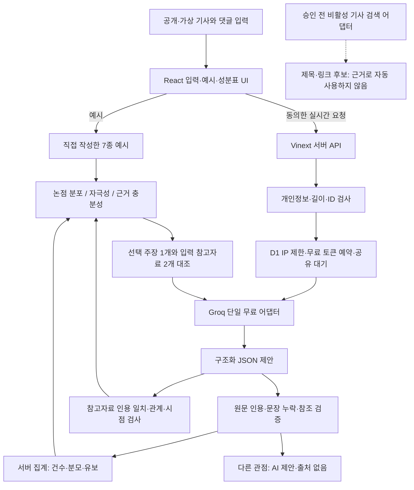

# 내 정보 맑음? — 아키텍처 v4.1

2026-10-30. 현재 구현 기준. 기술명세·개발계획 v4.1과 함께 적용합니다.

## 경계
- 브라우저에는 키가 없습니다. 전송 동의 문구는 실제 AI가 켜진 경우에만 표시하고 제공자 표시는 PROVIDER_NAME 상수를 사용합니다. 예시는 외부 호출 없이 동작합니다.
- API는 입력 기록을 저장하지 않습니다. D1에는 요청 ID·IP 해시·시간·토큰 수·활성 상태·대기 기한만 있습니다. 본문·참고자료·분류 결과·IP 원문은 기록하지 않습니다. 사용자가 직접 내보낸 JSON은 사용자 파일입니다.
- 언어모델은 해석 후보를 제안합니다. 서버가 UTF-16 start/end와 quote 일치, 원문 ID, 문장 커버리지, 대상 claimId를 검증합니다. 최종 수치는 서버가 계산합니다. 인용 존재와 의미 해석의 정확성은 별개입니다.
- 다른 관점의 basis는 반론 대상의 원문이며 그 제안을 입증하는 근거가 아닙니다. 출처 있는 다른 관점은 링크와 입력 자료의 인용 일치 검사를 통과한 것만 표시합니다.
- 검색은 고정 GDELT 주소만 사용하도록 준비됐지만 승인과 약관 검토가 끝나지 않아 차단되어 있습니다. 임의 기사 주소를 서버 네트워크 대상으로 사용하지 않습니다. 원문 취득은 비활성입니다.

## 자원·실패
Groq만 등록하며 유료 fallback은 없습니다. 요청 6,500토큰 예약, 전체 60초 창 7,000토큰, 동시 1건, IP 3/분·20/시간. 실제 콘솔 TPD/RPD×0.8과 자체 예산 중 작은 한도를 적용하며 현재 일일 120,000토큰·500회입니다. 미확인 콘솔 한도로 공개 활성화하지 않습니다. 429 공유 대기, 60초 마감, 사용량 불명은 보수적 예약 유지, 형식·인용 실패는 유보/부분 결과. 일일 소진 때 예시로 안내합니다.

## 배포와 연구
Sites의 서버 런타임과 D1을 사용하므로 사용자 PC를 상시 서버로 쓰지 않습니다. 서버 환경변수는 native Sites에 저장하고 저장 버전 재배포로 적용합니다. 정적 GitHub 호스팅만으로 비밀키 호출 서버를 대체하지 않습니다.

PCA·임베딩·SVM 비교는 선택 연구 경로로 제품 필수 경로와 분리합니다. 사람 라벨 40사례의 비교 스크립트는 실제 정답이 없으면 미평가로 보고합니다. 브라우저 확장은 미래 기능입니다.

정상 문장 ID 압축→서버 복원→전 문장 커버리지 검사 경계를 추가했습니다. 서버 HMAC은 선택 IP_HASH_SECRET 또는 도메인 분리한 기존 서버 Groq키에서 파생하며 키를 노출하지 않습니다. 기본 페이지 이동은 프레임워크 링크의 런타임 오류를 피하도록 표준 HTML 링크를 사용합니다.
