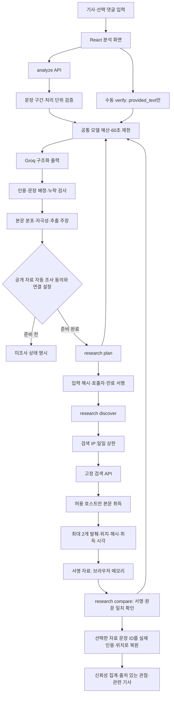

# 아키텍처 v5.0

2026-10-31 개발 기준. 자동 조사 코드는 존재하지만 검색 서비스는 승인·안정성 확인 전까지 비활성이다.

## 경계

- 모델은 문장 ID·분류를 제안하고 서버는 원문 인용·구간·분모를 결정한다. 처리 조각을 자연 문장 수로 표시하지 않는다.
- 사용자 입력 자료는 URL이 있어도 `provided_text`다. 서버 취득·서명 검증을 통과한 공개 발췌만 자동 신뢰성 집계에 포함된다.
- 검색 결과 메타데이터는 근거나 반대 입장을 뜻하지 않는다. 기사 본문 인용과 대조·입장 결과를 확인해야 추천 카드에 표시한다.
- 사실 상충과 의견 반대를 구별한다. AI 관점 제안은 출처 있는 기사와 다른 경로이며 출처 없음으로 표시한다.
- D1은 모델 호출 예산, 검색 요청 상한, 공급자 대기 상태를 원자적으로 관리한다. 원문·검색어·결과를 저장하지 않는다. 서명 묶음은 서버 저장소를 대체하는 브라우저 보유 자료이며 암호화가 아니다. 공개 자료만 포함하고 만료·호출자 바인딩을 적용한다.
- 모델 호출 사이 대기는 브라우저 실행기가 담당한다. 요청 하나를 수 분 열어 두거나 무료 상한을 올리지 않는다. 취소하면 새 단계 실행을 중단한다.

## 파일 책임

| 영역 | 파일 |
|---|---|
| 자연 문장·구간 | `lib/segmentation.ts` |
| 분석 계약·집계 | `lib/contracts.ts`, `lib/domain.ts` |
| 본문·댓글 분포 화면 | `components/topic-distribution.tsx` |
| 자동 조사 계약·집계 | `lib/research-contract.ts`, `lib/reliability.ts` |
| 브라우저 단계·화면 | `lib/research-runner.ts`, `components/reliability-research.tsx` |
| 조사 API·서명 | `app/api/research/route.ts`, `lib/server/research.ts`, `lib/server/research-token.ts` |
| 검색·취득·상한 | `lib/server/news.ts`, `lib/server/retrieval.ts`, `lib/server/search-budget.ts` |
| 모델·인용 대조 | `lib/server/verify.ts`, `lib/server/language.ts` |
| 운영 메타데이터 | `db/schema.ts`, `drizzle/0002_research_search_budget.sql` |

## 남은 구조적 개선

현재 검색 공급자 안정성 미확인, 단순 HTML 본문 정리 방식, 의견만 있는 글의 탐색 부족, 브라우저 진행 UI 미검증이 남았다. 자동 조사 기능을 켜기 전에 해결한다. 제공자별 어댑터는 약관과 실측 확인 후 추가하며 유료 자동 전환 경로는 만들지 않는다.

## 2026-11-02 후속 구현 상태

위 미완료 목록 중 의견만 있는 글·사용자 지정 비교 명제 탐색, 조사 취소·재시작·입력 변경, 모바일·팝업 진행 UI는 모의 응답과 로컬 브라우저로 검증했다. 비교 명제는 사실 주장과 별도 차원으로 전달하며 원문 인용이나 사실 완료 수에 추가하지 않는다. 문서 해독·본문 후보 추출은 `lib/server/article-document.ts`로 분리했고, 메인·조사 패널·추천·좌표·내보내기의 현재 분석 연결을 보완했다.

실제 검색 공급자·허용 출처별 취득·모델 정확도 검증은 여전히 남았다. 현재 범위와 결과는 [2026-11-02 품질 점검](SESSION_SITE_QUALITY_2026-11-02.md)을 기준으로 읽는다.
